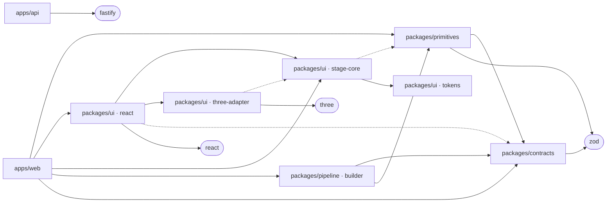

# Architecture

How PaperPlay fits together today. The concepts named here are explained in
[concepts.md](concepts.md); why things are this way is in [decisions/](decisions/).

## Package map

| Path | Job | Key exports or entry points |
|---|---|---|
| `packages/contracts` | Zod schemas and inferred types: the shared language | `Origin`, `Anchor`, `SourceManifest`, `PrimitiveRef`, `Action`, `RunEvent`, `RunRecord`, `JobState`, `WorldSpec` (with `Level`, `Counterfactual`, `DepthVariant`, `DesignSpec`, `PlaceholderAnchor`, `PendingSource`) |
| `packages/primitives` | Deterministic, fixed-step scientific models, their registry, and run replay | `flockPlanarWeighted`, `flockNeighbours` (Q1), `flockHeadings` (Q2), `flockReadsAsOneGroup` (O1), `flockSpread` (Q3), `flockAtRocks` (Q4), `mulberry32`, `registry`, `runEvents`, `replayRecord` |
| `packages/ui` | Design tokens, fonts, the stage, the bench and the game-first HUD | `@paperplay/ui/tokens`, `fonts.css`, `components.css`, `hud.css`, `stage-core`, `three-adapter`, `react` |
| `packages/pipeline` | Agent roles, model adapters, checks, controller | `buildWorld`, the deterministic builder in `src/builder/` (ADR-0016); `summarise` and `claimHolds`, a fork's measured difference (ADR-0018); the agents and adapters arrive at G3 |
| `apps/web` | React shell: owns the run, renders state, submits actions | `src/world/session.ts`, `src/world/LocalWorld.tsx` at `/world/local`, `src/world/local-world.ts`; `src/world/authored-world.ts`, which builds `fixtures/worldspecs/flocking-reference.json` with the builder at start-up; `src/hook/HookWorld.tsx` at `/world/hook`, the six levels played from the built world, and `src/hook/guide.ts`, the guide from each level's script; `src/world/fork.ts`, a level's fork (ADR-0019); `explorationLines` in `src/hook/guide.ts`, guided exploration; the dev-only capture page `capture.html` with `src/capture/` (ADR-0010) |
| `apps/api` | Fastify API: will hold secrets and run jobs | `GET /health` only, until G3 |
| `scripts/` | Gate, docs checker, land, defaults sweep, hook seed, group-measure sweep, levels sweep, demo capture, the built app served as Vercel would | `check-gate.ts` (with `gate/worlds.ts`), `check-docs.ts`, `land.ts` (with `land/land.ts` and `land/guard.ts`, ADR-0009), `hooks/pre-push.ts` and `hooks/install.ts`, `sweep-defaults.ts`, `hook-seed.ts`, `group-measure.ts`, `levels.ts`, `capture-demo.ts`, `serve-dist.ts`; `scripts/test/bundle.test.ts` builds the production bundle |
| `fixtures/oracles/` | Hand-derived expected behaviours for primitives | See `fixtures/oracles/README.md` |
| `fixtures/worldspecs/` | Authored WorldSpecs | `flocking-reference.json`, a draft with placeholder anchors until the source map exists |
| `fixtures/bindings/` | Hand-written binding fixtures: the variable each level's control must move, its fork and setup | `flocking-reference.json` |
| `eval/` | Sweeps now; the frozen protocol and raw attempts from G4 | `eval/sweeps/` |
| `.githooks/` | The repository's git hooks, which npm's `prepare` script tells git to use | `pre-push`, which refuses any push that would move `main` to a commit land has not recorded (ADR-0009) |
| `tests/e2e/` | Playwright browser tests on Chromium | `world.spec.ts` [R04], `hook.spec.ts` [R05] [R06], `accessibility.spec.ts` [R12], `stage.spec.ts`, `fonts.spec.ts`, `smoke.spec.ts` |

Inside `packages/ui`:
- **`src/tokens.ts`:** the accepted palette.
- **`src/fonts/`:** the self-hosted typefaces, Fredoka and Literata, declared in
  `fonts.css` as `@paperplay/ui/fonts.css` (ADR-0002).
- **`src/stage-core/`:** pure presentation; turns states into a `FrameDescription`. It also
  holds the view window and free rectangle (`screen.ts`) and the compass's geometry
  (`compass.ts`) (ADR-0012).
- **`src/three-adapter/`:** turns a `FrameDescription` into a Three.js scene: birds as a
  body and two hinged wings, trails as ribbons, and the valley with its meadow, lake, trees,
  rocks, sky and sun (ADR-0013).
- **`src/react/`:** they display what a driver gives them and report what the learner does.
  - From G1: WorldStage, LabBench, Readout, and the origin chip and legend (ADR-0007).
  - The game-first HUD (ADR-0008, ADR-0012), styled by `hud.css`: LevelCard, Guide,
    PaperJournal, LevelMap, DepthToggle, HeadingCompass, OriginTag and `useFreeRect`.
  - Each level's readout, by its observable (ADR-0014, ADR-0018): HeadingCompass,
    SpacingGauge, SpreadDial, GroupsCounter and RocksCounter, sharing the `dial` styles.
  - The fork (ADR-0019): ForkView, with two WorldStages, and DifferenceChart.
  - The guide can ask a question with choices (`ask`), and speak inside a card (GuideNote).
  - SpeedButton, the speed control (ADR-0020); `advance` in `stage-core/fixed-step.ts` takes the speed. The level card shows and hides its elements by
    the id a depth variant names (ADR-0016).

## Dependency directions

An arrow means "may import". Dotted arrows are type-only imports.

Forbidden, and enforced (see the invariants table below):
- `contracts` importing anything but zod;
- `primitives` importing UI, apps, the pipeline or Node;
- `stage-core` importing Three.js, React or DOM libraries, or importing simulation values;
- `three-adapter` importing `primitives` or `contracts` in any form;
- `react` (the components) importing simulation values: types only, and React, from outside its package;
- the builder (`packages/pipeline/src/builder/`) importing anything but `contracts` and `primitives`: no model client, network or UI.

## Data flow

1. **The simulation moves only in fixed steps.** The session in `apps/web` takes whole
   1/60 s steps from `advance`, records each learner action as an event at the current
   step, applies it through `apply` or the parameter schema, and calls `step`. Its own
   plan replays through `runEvents` to the same state, bit for bit.
2. **Drawing reads finished states.** `describeFrame` receives the two latest states. The
   adapter draws the resulting description, and nothing flows back into the simulation.
3. **Replay rebuilds a run from a record.** It takes a `RunRecord`'s initial state and
   events, then compares every sample within the record's tolerance.

## Contracts and versions

| Contract | Version | Defined in |
|---|---|---|
| SourceManifest | `sourcemanifest/1` | `packages/contracts/src/provenance.ts` |
| RunRecord, with RunEvent (`param` · `place` · `remove`) | `runrecord/2` | `packages/contracts/src/run.ts` |
| Origin, Anchor, PrimitiveRef, Action, JobState | Versioned with the documents that embed them | `packages/contracts/src/` |
| WorldSpec, with Level, Counterfactual (and its MeasuredDifference and claim), DepthVariant, GuidedExploration, DesignSpec; drafts may hold placeholder anchors and a pending source | `worldspec/2` | `packages/contracts/src/worldspec.ts` (ADR-0016, ADR-0018) |
| `flock.planar.weighted` | 3.1.0: equations E1–E20, with the group measure of ADR-0015 (E14 groups, E18 stray share) and its reading O1, "one group"; E19 the largest group's spread and E20 birds at rocks (ADR-0018); defaults per ADR-0003, alignment range 0–4; and the read-only queries Q1 (neighbourhoods), Q2 (headings), Q3 (spread) and Q4 (birds at rocks), which do not change the version | `packages/primitives/src/flock/MODEL.md` |
| Oracle fixtures | `oracle/1` | `fixtures/oracles/README.md` |
| FrameDescription, with FrameEmphasis | Unversioned: in-process only, never persisted | `packages/ui/src/stage-core/frame.ts` |
| Gate definitions | Requirements per gate | `gates.json` |

## Invariants and where they are enforced

| Invariant | Enforced by | Where |
|---|---|---|
| Primitives are seeded and never read a clock | Lint (`Math.random`, `Date.now`, `performance.now` and `new Date` are banned); tests tagged [R01] | `eslint.config.js`, `packages/primitives/test/` |
| Primitives never mutate their inputs | Tests on deep-frozen states | `packages/primitives/test/flock.step.test.ts`, `packages/primitives/test/flock.edits.test.ts` |
| Same seed and events give bit-identical observables | The replay oracle and determinism tests [R01] | `packages/primitives/test/flock.determinism.test.ts` |
| Primitive behaviour matches hand-derived equations | Oracle fixtures [R01] | `fixtures/oracles/`, `packages/primitives/test/flock.oracles.test.ts` |
| Contracts depend only on zod | Lint | `eslint.config.js` |
| Contracts reject unknown keys and enforce their refinements | Tests [R03] | `packages/contracts/test/` |
| Every WorldSpec level has exactly one manipulable and one counterfactual; the hook comes first; paper-derived statements carry anchors; counterfactuals override parameters only; a bonus level claims nothing from the paper; a reviewed spec holds no placeholder | Zod refinements, with tests [R03] | `packages/contracts/src/worldspec.ts`, `packages/contracts/test/worldspec.test.ts` |
| Each level's control moves its declared engine variable, its fork applies exactly its overrides, and its setup lands at step 0 | Hand-written binding fixtures, run through the engine and compared with the primitive stepped directly [R08] | `fixtures/bindings/`, `packages/pipeline/test/bindings.test.ts` |
| The builder refuses what the registry contradicts and what the shell cannot draw, is deterministic, and calls no model | Tests [R08]; lint keeps it to contracts and primitives | `packages/pipeline/test/builder.test.ts`, `eslint.config.js` |
| `/world/hook` plays the six levels in order, each opening only once the one before has been moved through its range, and each readout shows the primitive's own value | Browser tests [R06], compared with Node | `tests/e2e/levels.spec.ts` |
| Each depth variant shows exactly the shell elements it names, and hides the rest | Browser test [R06] over every level and depth, read from the spec | `tests/e2e/levels.spec.ts` |
| Every level's stated effect holds on at least 16 of 20 skies, or, for a count claim after a prediction, is exactly right (the level rule) | A test re-runs `npm run sweep:levels` in its own Node process and holds `eval/sweeps/levels.md` to it byte for byte [R06] | `scripts/test/levels.test.ts`, `scripts/sweep/levels.ts` (ADR-0018) |
| A gate's reviewed worlds are reviewed: G2 cannot pass while the flocking world is a draft or holds a placeholder anchor | `check:gate`, from `gates.json`; tests [R03] | `scripts/gate/worlds.ts`, `scripts/test/gate-worlds.test.ts` |
| The built app runs under the deploy's Content-Security-Policy with no violation and no console error | Browser tests against the production build, served with `vercel.json`'s headers | `tests/e2e/csp.spec.ts`, `scripts/serve-dist.ts` (ADR-0017) |
| A level's setup is recorded as place events at step 0, so its run replays from its record | Tests [R07] | `apps/web/test/session.test.ts` |
| A fork's two worlds stay step for step together; opened at a level's start on seed 5, it measures exactly what the levels sweep records | Tests [R06], against direct runs and `eval/sweeps/levels.md` | `apps/web/test/fork.test.ts` |
| The fork shows two worlds side by side on a desktop, stacked on a phone, with the measured difference charted, and passes axe on both | Browser tests [R06] [R12] | `tests/e2e/fork.spec.ts` |
| A level that asks for a prediction asks it before its fork, and nothing scores it: no line calls a choice right or wrong | Tests [R06]; browser tests [R06] [R12] | `apps/web/test/guide.test.ts`, `tests/e2e/guided.spec.ts` |
| A run at 4x is the same run as at 1x: the same states bit for bit, the same events, and it replays from its record | Tests [R07]; the clock's tests | `apps/web/test/session.test.ts`, `packages/ui/test/fixed-step.test.ts` |
| Level 5's rocks counter shows the primitive's own count (E20) and rocks (Q4), and the stage lights exactly the rocks Q4 reports, in the one world and in both of the fork's | Tests on Q4 against E20 [R01]; the session; browser tests compared with Node [R06] | `packages/primitives/test/flock.rocks.test.ts`, `apps/web/test/session.test.ts`, `tests/e2e/rocks.spec.ts` |
| A rock casts no shadow, and a lit rock uses a material of a rock's own kind, so no rock makes a new stage compile shaders mid-run | Test | `packages/ui/test/three-adapter.test.ts` |
| When the browser takes a stage's WebGL context away, the stage says so and offers "Tap to reload the world", or resumes by itself when the context comes back; the run never notices | Browser tests that lose the context with `WEBGL_lose_context`, then restore it or reload, checking pixels and the run's step [R12] | `tests/e2e/context.spec.ts`, `packages/ui/src/three-adapter/mount.ts` (ADR-0022) |
| The fork's chart spans its card and draws at one unit to a CSS pixel, so its 12 px labels stay 12 px on a phone | Browser test on a phone [R12] | `tests/e2e/fork.spec.ts`, `packages/ui/src/react/DifferenceChart.tsx` (ADR-0019) |
| A disposed stage releases its WebGL context at once, so stages mounted later start as quickly | Browser test: a closed fork's two contexts are lost | `tests/e2e/fork.spec.ts`, `packages/ui/src/three-adapter/mount.ts` |
| The renderer never changes an observable, even with a bird picked, the spread ring drawn, rocks lit, the view framed in a HUD's window, or the flock coloured by heading with wingbeats and trails | Test [R02]; in the browser, colour by heading records nothing and the run matches Node bit for bit [R02] | `packages/ui/test/render-invariance.test.ts`, `tests/e2e/world.spec.ts` |
| Every colour on the heading wheel keeps 3:1 against the meadow; trails never cross a seam and stay under 3.5 units | Tests | `packages/ui/test/world-art.test.ts` |
| The following camera keeps the flock's centre inside the HUD's free rectangle, and is the still overview under reduced motion | Browser tests | `tests/e2e/hook.spec.ts` |
| The HUD at rest covers at most 25% of 1440 × 900 and 35% of 390 × 844, and the stage frames the field inside the rectangle it leaves free | Browser tests that measure the HUD's boxes and read the stage's own fit; unit tests on the fit | `tests/e2e/hook.spec.ts`, `packages/ui/test/screen.test.ts` |
| The compass's arrow is the primitive's mean heading (Q2) and agreement (E12), and its ticks point where the birds fly on screen | Tests | `packages/primitives/test/flock.headings.test.ts`, `packages/ui/test/compass.test.ts` |
| The stage core is framework-free, with type-only simulation imports | A tsconfig without the DOM library; lint | `packages/ui/src/stage-core/tsconfig.json`, `eslint.config.js` |
| The adapter never reads or writes simulation state | Lint and an import test | `packages/ui/test/three-adapter.test.ts` |
| The React stage and bench import no simulation code | Lint (types only) | `eslint.config.js` |
| A live session replays exactly from its own record | Test [R04]: `runEvents` on the session's plan reaches its state bit for bit | `apps/web/test/session.test.ts` |
| A control moves the engine parameter, and readouts show the primitive's values | Browser tests [R04], compared with Node bit for bit | `tests/e2e/world.spec.ts` |
| Readouts update at most ten times a second, never once per frame | `readoutDue`, tested; the stage's loop calls it | `packages/ui/test/fixed-step.test.ts`, `packages/ui/src/react/WorldStage.tsx` |
| The local world's controls are valid actions on the primitive's variables, within its ranges | Test | `apps/web/test/session.test.ts` |
| The page's palette equals the stage's tokens | Test | `packages/ui/test/tokens.test.ts` |
| The opening seed follows ADR-0003's rule, under the group measure's reading O1 | A test re-runs the rule | `scripts/test/hook-seed.test.ts` |
| The group measure meets the owner's criteria: random scatters read as one group in under 1% of seeds (95% upper bound), and seed 4 reads as one group at 20 s | A test re-runs the sweep, checks both, and holds `eval/sweeps/group-measure.md` to a fresh run byte for byte; its evaluation copy of the measure equals the primitive's | `scripts/test/group-measure.test.ts` |
| Replay refuses another primitive version and out-of-range events | Tests [R07] | `packages/primitives/test/replay.test.ts` |
| Evidence comes only from the pinned runtime | The gate's runtime check, locally and in CI | `scripts/check-gate.ts`, `.github/workflows/check-gate.yml` |
| No skipped tests, no missing scripts, no pass-with-no-tests | The gate's evidence rules; Vitest (`passWithNoTests` and `allowOnly` both false); Playwright (`forbidOnly`, no retries) | `scripts/gate/evidence.ts`, `vitest.config.ts`, `playwright.config.ts` |
| Each gate requirement has passing tagged tests | `check:gate` | `gates.json` |
| Docs stay consistent with the repository | `check:docs`, inside `check:gate` | `scripts/docs/check.ts` |
| `main` moves only to a commit that passed `check:gate` locally and CI on that same commit | `npm run land`, the only routine way `main` moves; the pre-push hook refuses any other push that would move or delete `main`; tests on throwaway repositories, a planted failing gate among them | `scripts/land/land.ts`, `scripts/land/guard.ts`, `.githooks/pre-push`, `scripts/test/land.test.ts` (ADR-0009) |
| Browser tests render WebGL in software | Launch flags, and a test that asserts SwiftShader was used | `playwright.config.ts`, `tests/e2e/stage.spec.ts` |
| Fonts come from the page's own origin, and only the shipped weights are declared or rendered | A unit test on the font files; a browser test that blocks off-origin requests | `packages/ui/test/fonts.test.ts`, `tests/e2e/fonts.spec.ts` |
| `/world/local` has no WCAG 2.x A or AA violation that axe can detect, in four states, at 1280 and 360 px | Browser tests [R12] | `tests/e2e/accessibility.spec.ts` |
| The demo capture advances a fixed two steps per video frame, replays from its own record, and ends on one group; its scripted camera never jumps and is the same every run | Tests, on both runtimes | `apps/web/test/demo-script.test.ts`, `scripts/test/capture.test.ts` |
| **Per runtime:** the demo capture's bytes are the same on every run | Two runs on macOS arm64 and two on Linux x86-64 in CI, each pair byte-identical. The two runtimes give different bytes (see Claims per runtime) | 2026-10-09 logs; `.github/workflows/check-gate.yml` (capture job) |
| The capture page never ships | The production build has one entry, `index.html` | `apps/web/vite.config.ts` (Vite's default input) |
| Three.js loads as its own chunk, never in the entry chunk | A test builds the production bundle and reads its chunks | `scripts/test/bundle.test.ts`, `packages/ui/src/react/WorldStage.tsx` |
| The deploy builds the repository's own build, from a clean install, and serves the app on every path | A test reads `vercel.json` against `package.json` | `scripts/test/bundle.test.ts`, `vercel.json` (ADR-0017) |
| Secrets stay server-side | Not yet enforced (G3) | — |

## Runtime and tooling

- **Node 24.21.0,** pinned three ways: `.node-version`, `engines` with `engine-strict`, and
  the gate's runtime check. Node runs TypeScript directly (type stripping), so scripts and
  the API need no build.
- **TypeScript 6.0, strict and NodeNext.** Each workspace typechecks its source and its tests
  separately, and `npm run typecheck` covers the browser tests in `tests/e2e` too. It is pinned below 6.1 for typescript-eslint (ADR-0001).
- **Web:** Vite 8, React 19.3, and Three.js 0.186 (ADR-0004).
- **Tests and lint:** Vitest 5, with one project per workspace (`apps/web` included) and a JSON report. Playwright
  1.63 runs on Chromium with forced SwiftShader, and `@axe-core/playwright` 4.13 runs the
  axe scans. ESLint 10 has type-aware rules and the
  boundary rules above.
- **CI:** `.github/workflows/check-gate.yml` runs `check:gate` on ubuntu-latest, with the
  Node in `.node-version`, on every push and pull request. On `main` and on demand, a second
  job films the demo capture on Linux, so its hashes can be compared with the Mac's
  (ADR-0011). Every invariant below is checked on both runtimes:
  - macOS on arm64, locally;
  - Linux on x86-64, in CI.

  A claim that holds on one runtime only says so.

### Claims per runtime

Found on 2026-10-09, when CI first ran (session log 2026-10-09-2).

- **Hold on both runtimes:** every test in the gate. That includes:
  - the bitwise determinism and replay tests, within a runtime (R01);
  - the oracle fixtures;
  - the hook-seed rule (seed 5 since flock 3.0.0);
  - the group measure's sweep;
  - the demo script's one-group property;
  - render invariance (R02);
  - the browser tests.
- **Per runtime: the demo capture's bytes.**
  - Each runtime makes byte-identical frames and videos on every run.
  - macOS arm64 and Linux x86-64 make different bytes from the same code, Chromium
    153.0.8010.12 and SwiftShader.
  - The frames differ by rendering noise only. Mean difference 0.14–0.23 of 255, at most
    19, and under 0.07% of pixels differ by more than 8.
  - Bird pixels overlap 99.3–99.6% at 0, 7.5 and 14.9 s, so the run itself agrees across
    runtimes and the drawing differs. The likeliest cause is SwiftShader's code generation
    on the two architectures.
- **Canonical for published captures:** CI's capture job on a pinned `ubuntu-24.04` image
  (owner, 2026-10-09; ADR-0010).
- **Not compared across runtimes:** R01's bit-identical observables are a within-runtime
  claim, as R01 says ("on one runtime"). No test yet compares a Mac run with a Linux run
  bit for bit.
- **Libraries:** Zod 4.6 for contracts, Fastify 5 for the API.
- **Scripts:**
  - `check:gate` runs typecheck, lint, check:docs, test, build and test:e2e, then checks
    the evidence;
  - `check:docs` checks the documentation;
  - `land` lands the current branch on `main`, through the gate and CI (ADR-0009);
  - `sweep:defaults` reproduces ADR-0003's sweep;
  - `choose:hook-seed` re-applies ADR-0003's hook-seed rule;
  - `sweep:groups` re-runs ADR-0015's group-measure sweep, and exits 1 if a criterion fails;
  - `capture:demo` films the demo video into the git-ignored `captures/`, and with
    `-- --frames` a lossless PNG sequence too (ADR-0010).
- **The local world's settings** live in `apps/web/src/world/local-world.ts`. They are
  teaching choices: the hook seed now, and its levels until WorldSpec arrives at G2.

## Changes

| Date | Commit | Change |
|---|---|---|
| 2026-09-28 | c18488d | Monorepo skeleton; contracts (G1 subset); `flock.planar.weighted@1.0.0`; `check:gate` with requirement evidence |
| 2026-09-30 | a5ca4df | `runrecord/2`; flock 2.0.0 (named entities, `apply`, `stateSchema`); the replay engine |
| 2026-09-30 | cdaf66f | Flock 2.1.0 defaults; the sweep scripts and `eval/sweeps/` |
| 2026-09-30 | f89a2db | `packages/ui` (tokens, stage-core, three-adapter); `apps/web` draws the stage; Playwright on SwiftShader |
| 2026-10-01 | c84333d | `check:docs` runs inside every gate |
| 2026-10-01 | a93e033 | Flock 2.2.0: alignment's range widens to 0–4 |
| 2026-10-01 | ef7eb32 | The hook seed (4) in `apps/web/src/world/local-world.ts`, with `choose:hook-seed` and a drift test |
| 2026-10-01 | 788a1a3 | Self-hosted fonts in `packages/ui/src/fonts`, exported as `@paperplay/ui/fonts.css` |
| 2026-10-01 | 109e9c6 | The read-only neighbourhood query `flockNeighbours` (Q1) |
| 2026-10-01 | 73c491e | `FrameEmphasis`, picking, rings; the fit backs off in inverse proportion to the aspect; fog keeps its distance |
| 2026-10-01 | 107a38a | `packages/ui/src/react` (WorldStage, LabBench, origins); the session and `/world/local` in `apps/web`; a Vitest project for `apps/web`; `src/stage/local-stage.ts` removed |
| 2026-10-09 | 3639dfb | The axe scan in `test:e2e` [R12]; `npm run typecheck` covers `tests/e2e` |
| 2026-10-09 | edfadad | `npm run capture:demo`: the dev-only capture page, the demo script, Playwright's ffmpeg (ADR-0010) |
| 2026-10-09 | 0d740e4 | CI on GitHub Actions (ADR-0011) |
| 2026-10-09 | 90fc458 | Flock query Q2, headings |
| 2026-10-09 | a7e30ce | Stage core: the view window, `screen.ts`, `compass.ts`; the adapter draws the frame's projection (ADR-0012) |
| 2026-10-09 | 15673c8 | The game-first HUD in `packages/ui/src/react`, with `hud.css` (ADR-0008) |
| 2026-10-09 | 445912e | `/world/hook` on the shell |
| 2026-10-09 | 2d9768e | Stage core: colour by heading, wingbeats, trails, a camera target, `flockCentre` (ADR-0013) |
| 2026-10-09 | 4d3bcce | The adapter's low-poly valley and birds: wings, trails, terrain, lake, trees, rocks, sky, sun |
| 2026-10-09 | b27240e | WorldStage's `framing` and `look`; the session's trail history |
| 2026-10-09 | 7c12a97 | The capture's scripted camera path; `StageDriver.camera()` |
| 2026-10-09 | 5d87b66 | Flock 3.0.0: the group measure (E14, E18, O1); the hook seed moves to 5, and the demo capture names seed 4 (ADR-0015) |
| 2026-10-09 | f37c9a9 | `npm run sweep:groups` and `eval/sweeps/group-measure.md` |
| 2026-10-09 | 0afc49d | `worldspec/1` in `packages/contracts`; `Action` is built by `actionWith(anchor)` |
| 2026-10-09 | 211f13a | `fixtures/worldspecs/flocking-reference.json`, a draft |
| 2026-10-09 | 4d942fd | The builder in `packages/pipeline/src/builder/`, a Vitest project for the pipeline, and `fixtures/bindings/` |
| 2026-10-09 | d2e9f9f | The session takes a level's setup, and `load()`s another level on the same stage |
| 2026-10-09 | e5c30b7 | `/world/hook` from the built world: `authored-world.ts`, the guide from scripts, SpacingGauge, GroupsCounter, the `dial` styles; `hook-content.ts` removed |
| 2026-10-09 | 2ce3b34 | WorldStage loads the Three.js adapter with `import()`; `vercel.json` (ADR-0017) |
| 2026-10-09 | 7f9c547 | Flock 3.1.0: E19, E20 and Q3 |
| 2026-10-09 | 3647ec5 | `worldspec/2`; `src/builder/difference.ts`; `npm run sweep:levels` and `eval/sweeps/levels.md` (ADR-0018) |
| 2026-10-09 | 804038a | The spread ring (the frame's `spread` emphasis) and SpreadDial |
| 2026-10-09 | e09ecd9 | `gates.json` `reviewedWorlds`; `scripts/gate/worlds.ts` |
| 2026-10-09 | b4503a5 | The deploy's CSP and headers; `scripts/serve-dist.ts`; a second Playwright web server; `apps/web/src/strict-csp.ts` |
| 2026-10-09 | 6c9a5a2 | The session's `start` and `stepBy` |
| 2026-10-09 | 8d62794 | The fork: `src/world/fork.ts`, ForkView, DifferenceChart; WorldStage's `name` |
| 2026-10-09 | 85e43fe | Guided exploration: the guide's `ask`, GuideNote, `explorationLines` |
| 2026-10-09 | b6e00d3 | The speed control: `advance`'s speed, the session's and the fork's `setSpeed`, SpeedButton |
| 2026-10-09 | 92cb65f | A disposed stage releases its WebGL context (`forceContextLoss`) |
| 2026-10-09 | 3454a1d | `npm run land` and the pre-push hook on `main`: `scripts/land/`, `scripts/hooks/`, `.githooks/` (ADR-0009) |
| 2026-10-09 | 29f9646 | Flock query Q4 (`flockAtRocks`); RocksCounter; the frame's touched rocks and the adapter's `touchedMaterial`; rock markers cast no shadow |
| 2026-10-09 | 7c81d9f | `mountStage` handles context loss: the lost notice, restore, and "Tap to reload the world" (ADR-0022); DifferenceChart draws at its measured width; SpeedButton says "Speed 1×"; `tests/e2e/pixels.ts` |
