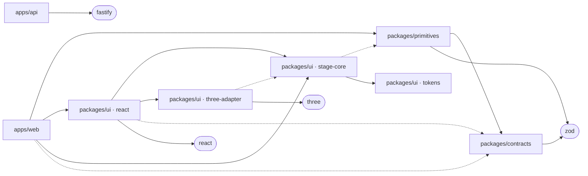
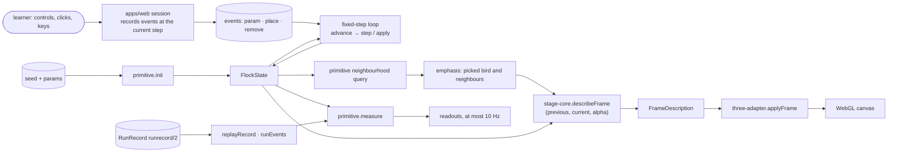

# Architecture

How PaperPlay fits together today. The concepts named here are explained in
[concepts.md](concepts.md); why things are this way is in [decisions/](decisions/).

## Package map

| Path | Job | Key exports or entry points |
|---|---|---|
| `packages/contracts` | Zod schemas and inferred types: the shared language | `Origin`, `Anchor`, `SourceManifest`, `PrimitiveRef`, `Action`, `RunEvent`, `RunRecord`, `JobState` |
| `packages/primitives` | Deterministic, fixed-step scientific models, their registry, and run replay | `flockPlanarWeighted`, `flockNeighbours`, `mulberry32`, `registry`, `runEvents`, `replayRecord` |
| `packages/ui` | Design tokens, fonts, the stage and the bench | `@paperplay/ui/tokens`, `fonts.css`, `components.css`, `stage-core`, `three-adapter`, `react` |
| `packages/pipeline` | Agent roles, model adapters, checks, controller | Empty until G3 |
| `apps/web` | React shell: owns the run, renders state, submits actions | `src/world/session.ts`, `src/world/LocalWorld.tsx` at `/world/local`, `src/world/local-world.ts`; the dev-only capture page `capture.html` with `src/capture/` (ADR-0010) |
| `apps/api` | Fastify API: will hold secrets and run jobs | `GET /health` only, until G3 |
| `scripts/` | Gate, docs checker, defaults sweep, hook seed, demo capture | `check-gate.ts`, `check-docs.ts`, `sweep-defaults.ts`, `hook-seed.ts`, `capture-demo.ts` |
| `fixtures/oracles/` | Hand-derived expected behaviours for primitives | See `fixtures/oracles/README.md` |
| `eval/` | Sweeps now; the frozen protocol and raw attempts from G4 | `eval/sweeps/` |
| `tests/e2e/` | Playwright browser tests on Chromium | `world.spec.ts` [R04], `accessibility.spec.ts` [R12], `stage.spec.ts`, `fonts.spec.ts`, `smoke.spec.ts` |

Inside `packages/ui`:
- **`src/tokens.ts`:** the accepted palette.
- **`src/fonts/`:** the self-hosted typefaces, Fredoka and Literata, declared in
  `fonts.css` as `@paperplay/ui/fonts.css` (ADR-0002).
- **`src/stage-core/`:** pure presentation; turns states into a `FrameDescription`.
- **`src/three-adapter/`:** turns a `FrameDescription` into a Three.js scene.
- **`src/react/`:** WorldStage, LabBench, Readout, and the origin chip and legend
  (ADR-0007). They display what a driver gives them and report what the learner does.

## Dependency directions

An arrow means "may import". Dotted arrows are type-only imports.

Forbidden, and enforced (see the invariants table below):
- `contracts` importing anything but zod;
- `primitives` importing UI, apps, the pipeline or Node;
- `stage-core` importing Three.js, React or DOM libraries, or importing simulation values;
- `three-adapter` importing `primitives` or `contracts` in any form;
- `react` (the components) importing simulation values: types only, and React, from outside its package.

`packages/pipeline` has no imports yet.

## Data flow

1. **The simulation moves only in fixed steps.** The session in `apps/web` takes whole
   1/60 s steps from `advance`, records each learner action as an event at the current
   step, applies it through `apply` or the parameter schema, and calls `step`. Its own
   plan replays through `runEvents` to the same state, bit for bit.
2. **Drawing reads finished states.** `describeFrame` receives the two latest states. The
   adapter draws the resulting description, and nothing flows back into the simulation.
3. **Replay rebuilds a run from a record.** It takes a `RunRecord`'s initial state and
   events, then compares every sample within the record's tolerance.

## Contracts and versions

| Contract | Version | Defined in |
|---|---|---|
| SourceManifest | `sourcemanifest/1` | `packages/contracts/src/provenance.ts` |
| RunRecord, with RunEvent (`param` · `place` · `remove`) | `runrecord/2` | `packages/contracts/src/run.ts` |
| Origin, Anchor, PrimitiveRef, Action, JobState | Versioned with the documents that embed them | `packages/contracts/src/` |
| WorldSpec | `worldspec/1`, planned | G2 |
| `flock.planar.weighted` | 2.2.0: equations E1–E17, defaults per ADR-0003, alignment range 0–4, and the read-only query Q1 (neighbourhoods), which does not change the version | `packages/primitives/src/flock/MODEL.md` |
| Oracle fixtures | `oracle/1` | `fixtures/oracles/README.md` |
| FrameDescription, with FrameEmphasis | Unversioned: in-process only, never persisted | `packages/ui/src/stage-core/frame.ts` |
| Gate definitions | Requirements per gate | `gates.json` |

## Invariants and where they are enforced

| Invariant | Enforced by | Where |
|---|---|---|
| Primitives are seeded and never read a clock | Lint (`Math.random`, `Date.now`, `performance.now` and `new Date` are banned); tests tagged [R01] | `eslint.config.js`, `packages/primitives/test/` |
| Primitives never mutate their inputs | Tests on deep-frozen states | `packages/primitives/test/flock.step.test.ts`, `packages/primitives/test/flock.edits.test.ts` |
| Same seed and events give bit-identical observables | The replay oracle and determinism tests [R01] | `packages/primitives/test/flock.determinism.test.ts` |
| Primitive behaviour matches hand-derived equations | Oracle fixtures [R01] | `fixtures/oracles/`, `packages/primitives/test/flock.oracles.test.ts` |
| Contracts depend only on zod | Lint | `eslint.config.js` |
| Contracts reject unknown keys and enforce their refinements | Tests [R03] | `packages/contracts/test/` |
| The renderer never changes an observable, even with a bird picked | Test [R02] | `packages/ui/test/render-invariance.test.ts` |
| The stage core is framework-free, with type-only simulation imports | A tsconfig without the DOM library; lint | `packages/ui/src/stage-core/tsconfig.json`, `eslint.config.js` |
| The adapter never reads or writes simulation state | Lint and an import test | `packages/ui/test/three-adapter.test.ts` |
| The React stage and bench import no simulation code | Lint (types only) | `eslint.config.js` |
| A live session replays exactly from its own record | Test [R04]: `runEvents` on the session's plan reaches its state bit for bit | `apps/web/test/session.test.ts` |
| A control moves the engine parameter, and readouts show the primitive's values | Browser tests [R04], compared with Node bit for bit | `tests/e2e/world.spec.ts` |
| Readouts update at most ten times a second, never once per frame | `readoutDue`, tested; the stage's loop calls it | `packages/ui/test/fixed-step.test.ts`, `packages/ui/src/react/WorldStage.tsx` |
| The local world's controls are valid actions on the primitive's variables, within its ranges | Test | `apps/web/test/session.test.ts` |
| The page's palette equals the stage's tokens | Test | `packages/ui/test/tokens.test.ts` |
| The opening seed follows ADR-0003's rule | A test re-runs the rule | `scripts/test/hook-seed.test.ts` |
| Replay refuses another primitive version and out-of-range events | Tests [R07] | `packages/primitives/test/replay.test.ts` |
| Evidence comes only from the pinned runtime | The gate's runtime check | `scripts/check-gate.ts` |
| No skipped tests, no missing scripts, no pass-with-no-tests | The gate's evidence rules; Vitest (`passWithNoTests` and `allowOnly` both false); Playwright (`forbidOnly`, no retries) | `scripts/gate/evidence.ts`, `vitest.config.ts`, `playwright.config.ts` |
| Each gate requirement has passing tagged tests | `check:gate` | `gates.json` |
| Docs stay consistent with the repository | `check:docs`, inside `check:gate` | `scripts/docs/check.ts` |
| Browser tests render WebGL in software | Launch flags, and a test that asserts SwiftShader was used | `playwright.config.ts`, `tests/e2e/stage.spec.ts` |
| Fonts come from the page's own origin, and only the shipped weights are declared or rendered | A unit test on the font files; a browser test that blocks off-origin requests | `packages/ui/test/fonts.test.ts`, `tests/e2e/fonts.spec.ts` |
| `/world/local` has no WCAG 2.x A or AA violation that axe can detect, in four states, at 1280 and 360 px | Browser tests [R12] | `tests/e2e/accessibility.spec.ts` |
| The demo capture advances a fixed two steps per video frame, replays from its own record, and ends on one group | Tests; two runs gave byte-identical videos (2026-10-09 log) | `apps/web/test/demo-script.test.ts`, `scripts/test/capture.test.ts` |
| The capture page never ships | The production build has one entry, `index.html` | `apps/web/vite.config.ts` (Vite's default input) |
| Secrets stay server-side | Not yet enforced (G3) | — |

## Runtime and tooling

- **Node 24.21.0,** pinned three ways: `.node-version`, `engines` with `engine-strict`, and
  the gate's runtime check. Node runs TypeScript directly (type stripping), so scripts and
  the API need no build.
- **TypeScript 6.0, strict and NodeNext.** Each workspace typechecks its source and its tests
  separately, and `npm run typecheck` covers the browser tests in `tests/e2e` too. It is pinned below 6.1 for typescript-eslint (ADR-0001).
- **Web:** Vite 8, React 19.3, and Three.js 0.186 (ADR-0004).
- **Tests and lint:** Vitest 5, with one project per workspace (`apps/web` included) and a JSON report. Playwright
  1.63 runs on Chromium with forced SwiftShader, and `@axe-core/playwright` 4.13 runs the
  axe scans. ESLint 10 has type-aware rules and the
  boundary rules above.
- **Libraries:** Zod 4.6 for contracts, Fastify 5 for the API.
- **Scripts:**
  - `check:gate` runs typecheck, lint, check:docs, test, build and test:e2e, then checks
    the evidence;
  - `check:docs` checks the documentation;
  - `sweep:defaults` reproduces ADR-0003's sweep;
  - `choose:hook-seed` re-applies ADR-0003's hook-seed rule;
  - `capture:demo` films the demo video into the git-ignored `captures/` (ADR-0010).
- **The local world's settings** live in `apps/web/src/world/local-world.ts`. They are
  teaching choices: the hook seed now, and its levels until WorldSpec arrives at G2.

## Changes

| Date | Commit | Change |
|---|---|---|
| 2026-09-28 | c18488d | Monorepo skeleton; contracts (G1 subset); `flock.planar.weighted@1.0.0`; `check:gate` with requirement evidence |
| 2026-09-30 | a5ca4df | `runrecord/2`; flock 2.0.0 (named entities, `apply`, `stateSchema`); the replay engine |
| 2026-09-30 | cdaf66f | Flock 2.1.0 defaults; the sweep scripts and `eval/sweeps/` |
| 2026-09-30 | f89a2db | `packages/ui` (tokens, stage-core, three-adapter); `apps/web` draws the stage; Playwright on SwiftShader |
| 2026-10-01 | c84333d | `check:docs` runs inside every gate |
| 2026-10-01 | a93e033 | Flock 2.2.0: alignment's range widens to 0–4 |
| 2026-10-01 | ef7eb32 | The hook seed (4) in `apps/web/src/world/local-world.ts`, with `choose:hook-seed` and a drift test |
| 2026-10-01 | 788a1a3 | Self-hosted fonts in `packages/ui/src/fonts`, exported as `@paperplay/ui/fonts.css` |
| 2026-10-01 | 109e9c6 | The read-only neighbourhood query `flockNeighbours` (Q1) |
| 2026-10-01 | 73c491e | `FrameEmphasis`, picking, rings; the fit backs off in inverse proportion to the aspect; fog keeps its distance |
| 2026-10-01 | 107a38a | `packages/ui/src/react` (WorldStage, LabBench, origins); the session and `/world/local` in `apps/web`; a Vitest project for `apps/web`; `src/stage/local-stage.ts` removed |
| 2026-10-09 | 3639dfb | The axe scan in `test:e2e` [R12]; `npm run typecheck` covers `tests/e2e` |
| 2026-10-09 | edfadad | `npm run capture:demo`: the dev-only capture page, the demo script, Playwright's ffmpeg (ADR-0010) |
